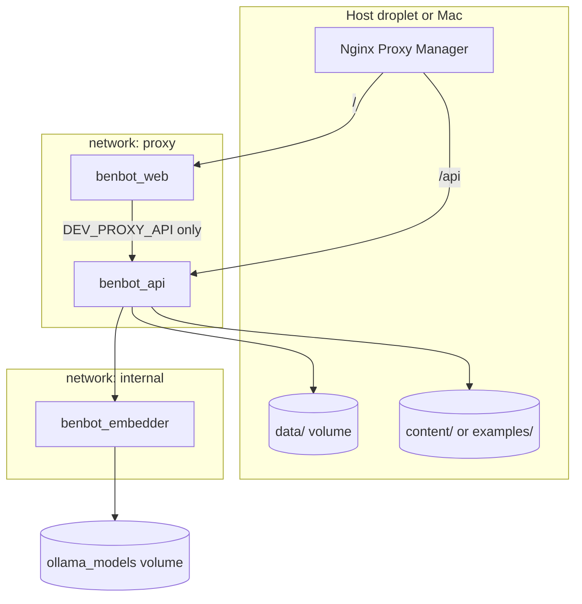

# Containers and networks

Compose project name is always `benbot`, no matter what the checkout directory is called.

## Diagram



## Services

| Service | Container | Image | Networks | Host ports (prod) | Host ports (dev) |
|---|---|---|---|---|---|
| api | benbot_api | `${BENBOT_IMAGE_PREFIX}/api:${BENBOT_TAG}` | proxy, internal | none | 127.0.0.1:8000 |
| web | benbot_web | `${BENBOT_IMAGE_PREFIX}/web:${BENBOT_TAG}` | proxy | none | 127.0.0.1:8080 |
| embedder | benbot_embedder | `${BENBOT_IMAGE_PREFIX}/embedder:${BENBOT_TAG}` | internal only | none | none |

Production services set `platform: linux/amd64`. Dev builds use the local architecture.

## Volumes

| Mount | Service | Mode | Purpose |
|---|---|---|---|
| `${BENBOT_HOME}/data` → `/app/data` | api | read-write | SQLite, NumPy index |
| `${BENBOT_HOME}/content` → `/content` | api (prod) | read-only | Private markdown |
| `${BENBOT_HOME}/examples` → `/content` | api (dev) | read-only | Sample markdown |
| `ollama_models` | embedder | read-write | Ollama model files |

Inside the api container, `DB_PATH=/app/data/benbot.sqlite` and `CONTENT_DIR=/content`. The app reads the index at `data/index` relative to `/app` (same layout as a host checkout).

## Environment

| Variable | Where | Meaning |
|---|---|---|
| `BENBOT_HOME` | compose | Host directory for `data/` and content mounts (default `.`) |
| `BENBOT_IMAGE_PREFIX` | compose | Registry path prefix for pulled images |
| `BENBOT_TAG` | compose | Image tag to pull (pin to roll back) |
| `PROXY_NETWORK` | compose | External Docker network name NPM uses |
| `DEV_PROXY_API` | web | `1` proxies `/api` to the api service (dev only) |
| `API_HOST` / `API_PORT` | api | Bind address ( `0.0.0.0:8000` in containers) |
| `LLM_BASE_URL` | api | Chat model (dev default: Mac Ollama via `host.docker.internal`) |
| `EMBED_BASE_URL` | api | Embedder (`http://embedder:11434/v1` in compose) |

## Commands

Production on the droplet (images already pushed):

```bash
docker compose pull
docker compose up -d
```

Local dev:

```bash
scripts/dev-up.sh
```

Open http://127.0.0.1:8080/ . The chat uses the Mac's Ollama for replies and the embedder container for vectors.

Build amd64 images for the droplet:

```bash
docker buildx build --platform linux/amd64 -f docker/api/Dockerfile -t "$BENBOT_IMAGE_PREFIX/api:$BENBOT_TAG" --push .
```

Repeat for `docker/web/Dockerfile` and `docker/embedder/Dockerfile`.

Render nginx config for inspection:

```bash
PYTHONPATH=. python web/dev/render_nginx.py
```

Ingest and backup services are added in BENBOT-25 and BENBOT-26.
